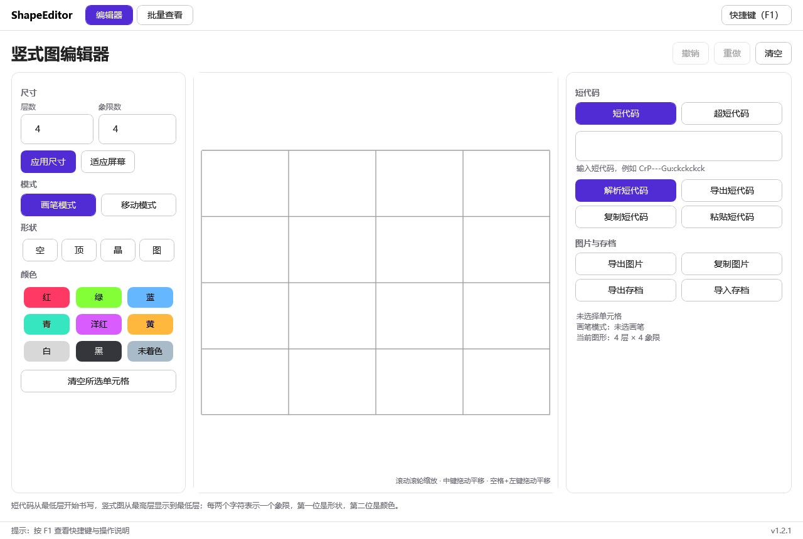

# 竖式图编辑器

把图形短代码转成竖式图、编辑图形并导出结果的工具，同一套核心逻辑提供 **Web / Android / Windows** 三个平台。



## 在线使用与下载

| 平台 | 入口 | 说明 |
| --- | --- | --- |
| Web | [wyucnk.github.io/ShapeEditor](https://wyucnk.github.io/ShapeEditor/) | Blazor WebAssembly + PWA，可离线使用 |
| Windows | [下载 EXE](https://github.com/WyuCnk/ShapeEditor/releases/latest/download/ShapeEditor-Windows-x64.exe) | 单文件自包含，约 59 MB，双击即用，无需安装 .NET |
| Android | [下载 APK](https://github.com/WyuCnk/ShapeEditor/releases/latest/download/ShapeEditor-android-universal.apk) | 通用包（arm64 / arm / x64），最低 Android 5.0 |
| 所有版本 | [Releases](https://github.com/WyuCnk/ShapeEditor/releases) | |

三个客户端共用同一份存档格式（JSON，`Version: 1`），互相导入导出没有障碍。

## 功能

三个平台能力基本一致：

- 解析、编辑、导出短代码，支持**短代码**与**超短代码**两种写法
- 任意层数与象限数（1–100，单元格总数上限 10000）
- 竖式图显示：**最高层在上，最低层在下**
- 形状画笔（空 / 顶针 / 晶体 / 普通形状）、颜色画笔（9 色），可组合使用
- 整体上移 / 下移，同层象限循环左移 / 右移
- 画布缩放与平移，选中单元格查看其短代码
- 撤销 / 重做（上限 100 步）
- 导出完整竖式图 PNG；Windows 还支持把图片复制到剪贴板
- 存档导入导出（JSON），自动保存并在下次打开时恢复
- 批量查看：粘贴或导入 txt（一行一条），分页缩略图，上一条 / 下一条切换
- 工作区：多画布标签页 + 共享素材库，节点间做下落 / 顶针 / 切割 / 堆叠，导出路径图 PNG

## 工作区（制作路径）

三个平台都有「工作区」页，用来把多个图形串成一条制作路径：

- **多工作区**：标签页切换，可新建、双击重命名、删除；每个工作区独立保存画布、下落规则与高度上限
- **共享素材库**：从编辑器「加入工作区」导入，所有工作区共用一份
- **节点运算**：素材节点 → 下落 / 顶针 / 切割（左右两半）/ 堆叠（另一个节点或直接导入），结果节点可以继续参与运算，一个节点可有多个下游
- **幂等**：同一操作重复点击只会定位到已有结果，不会重复建节点
- **引用**：堆叠的第二个输入可以是画布上任意已有节点，节点上标注「引用 #N」
- **删除**：只向下级联，不会删上游被引用的节点
- **规则与上限**：切换「含循环支撑 / 仅地面」或修改高度上限（4–100，默认 4）后，整张图按依赖顺序重算
- **导出**：路径图 PNG（节点按图形比例自适应高度，不含按钮）；工作区可导出 / 导入 JSON

各平台差异：

| 能力 | Web | Android | Windows |
| --- | --- | --- | --- |
| 分享图片 | 系统分享（浏览器支持时） | 系统分享 | 导出 + 剪贴板 |
| 自动保存位置 | 浏览器 localStorage | 应用私有存储 | `%LOCALAPPDATA%\ShapeEditor\autosave.json` |
| 快捷键 | 浏览器默认 | — | 全套（见下） |

## Windows 快捷键

首次使用按 **F1** 查看完整说明（菜单里也有入口），常用如下：

| 快捷键 | 功能 |
| --- | --- |
| `Ctrl + Z` / `Ctrl + Y` | 撤销 / 重做 |
| `Ctrl + Enter` | 解析输入框里的短代码 |
| `Ctrl + 0` | 适应屏幕 |
| `Ctrl + C` / `Ctrl + V` | 复制 / 粘贴短代码（焦点在输入框时走系统行为） |
| `Ctrl + S` / `Ctrl + O` | 导出 / 导入存档 |
| `Ctrl + Shift + S` | 导出图片 |
| `Delete` / `Esc` | 清空选中单元格 / 取消画笔与选中 |
| `↑ ↓ ← →` | 移动模式下整体移动 |
| 滚轮 / 中键拖动 / 空格+左键拖动 | 缩放 / 平移画布 |

## 短代码规则

冒号 `:` 分隔不同层，**第一段是最低层**；每两个字符表示一个象限，同一层按短代码顺序从左到右排列。

```text
CrP---Gu:ckckckck
```

表示两层、每层四个象限；竖式图显示时，第二段位于第一段上方。

| 代码 | 含义 |
| ---- | ---- |
| `--` | 空位 |
| `P-` | 顶针 |
| `cr` | 红色晶体 |
| `Cu` | 未着色普通形状 |
| `Gu` | 未着色的 G 普通形状 |

颜色字符：`r`、`g`、`b`、`c`、`m`、`y`、`w`、`k`、`u`，其中 `u` 是未着色，与空位/顶针的 `-` 不同。

### 超短代码

只描述形状、不带颜色：**每一位一个象限**，冒号同样分层。`C` 普通形状、`c` 晶体、`P` 顶针、`-` 空位，普通形状字母沿用 `A`–`Z`（`P` 除外）。

```text
CcCc
```

表示一层四个象限：图、晶、图、晶。解析时颜色按默认值补齐（普通形状未着色 `u`、晶体红色 `r`），因此随时可以再导出为带颜色的完整短代码。

## 项目结构

```text
ShapeEditor.Core/    图形模型、短代码解析与导出、主题常量（三端共享）
ShapeEditor.Web/     Blazor WebAssembly 在线版与 PWA
ShapeEditor.Maui/    Android 应用（MAUI 单项目）
ShapeEditor.Wpf/     Windows 桌面客户端（WPF）
ShapeEditor.Tests/   零依赖测试项目
Directory.Build.props  产品版本与 Android versionCode 的唯一来源
ShapeEditor.slnx     解决方案
```

三个界面都以 `ShapeEditor.Core` 为唯一真源：短代码解析/导出、文档模型、调色板与晶体条带算法都不在界面层重复实现。

## 本地开发

需要 .NET 10 SDK；Android 另外需要 MAUI 工作负载、Android SDK 与 JDK。

```powershell
# Web（热重载）
dotnet watch --project .\ShapeEditor.Web\ShapeEditor.Web.csproj

# Windows 客户端
dotnet run --project .\ShapeEditor.Wpf\ShapeEditor.Wpf.csproj

# 测试（36 项）
dotnet run --project .\ShapeEditor.Tests\ShapeEditor.Tests.csproj -c Release

# Android（按需传入本机 SDK 与 JDK 路径）
dotnet build .\ShapeEditor.Maui\ShapeEditor.Maui.csproj -f net10.0-android `
  -p:AndroidSdkDirectory="D:\AndroidSdk" -p:JavaSdkDirectory="D:\AndroidJdk"
```

### 发布 Windows 单文件

```powershell
dotnet publish .\ShapeEditor.Wpf\ShapeEditor.Wpf.csproj -c Release -p:PublishProfile=win-x64
```

输出在 `ShapeEditor.Wpf\bin\Release\net10.0-windows\publish\win-x64\ShapeEditor.Wpf.exe`。

### 离屏自检

没有图形界面时可以渲染界面到 PNG 验证绘制：

```powershell
.\ShapeEditor.Wpf\bin\Debug\net10.0-windows\ShapeEditor.Wpf.exe --render-test .\artifacts\render
```

## 版本管理

三端共用一个产品版本号，定义在 `Directory.Build.props` 的 `ProductVersion`，发版只改这一处：

- WPF：程序集版本与状态栏显示
- Web：顶栏显示（读取程序集 `InformationalVersion`）
- Android：`ApplicationDisplayVersion`，`versionCode` 由 `major*10000 + minor*100 + patch` 自动派生（只增不减）

## 发布流程

```powershell
# 1. 修改 Directory.Build.props 里的 ProductVersion
# 2. 提交后打标签
git tag -a v1.2.2 -m "ShapeEditor 1.2.2"
git push origin v1.2.2
```

打 `v*` 标签会触发 `.github/workflows/release.yml`：同时构建 Windows 单文件 EXE 与签名 APK，汇总到同一个 Release。网页上的两个下载按钮固定指向 `releases/latest/download/<固定文件名>`，因此发版后无需改网页。

推送 `main` 会触发 `deploy-pages.yml` 自动部署 Web 版。

## 后续计划

- 扩展基于 C# 的图形性质分析功能
- 批量查看导出长图（列表过长时的分页导出方案仍在设计）
- 持续优化 Web 版移动端体验

## 反馈

发现短代码解析、显示或导出问题，欢迎在 [Issues](https://github.com/WyuCnk/ShapeEditor/issues) 反馈，并附上短代码、预期结果与实际截图。
