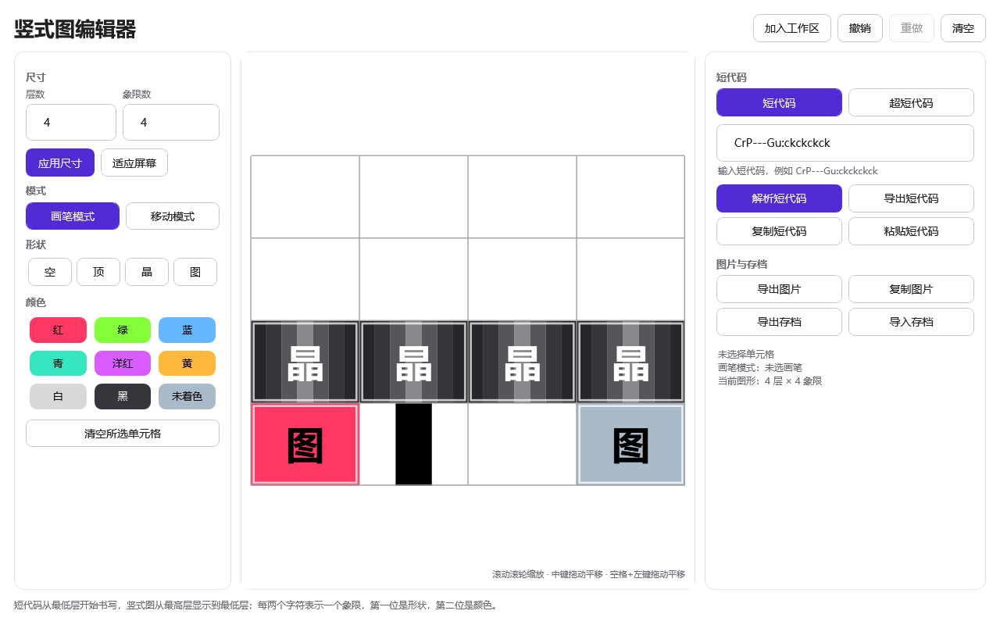
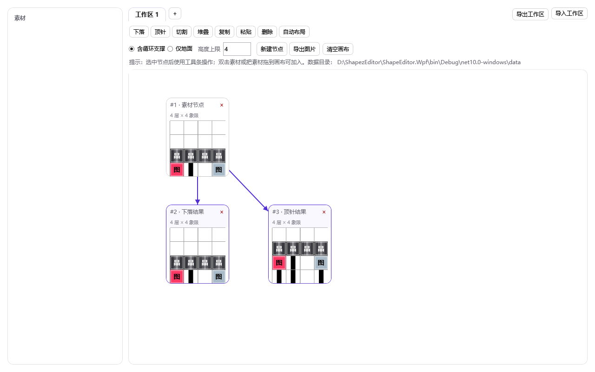
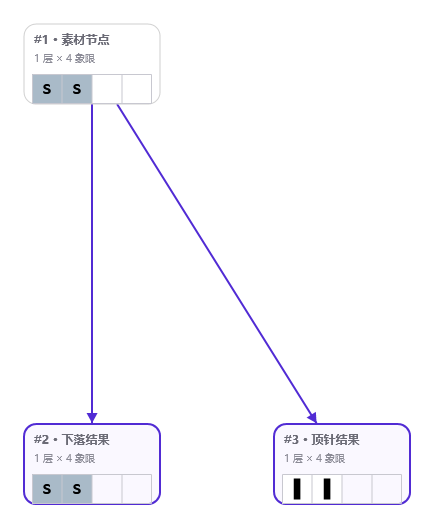
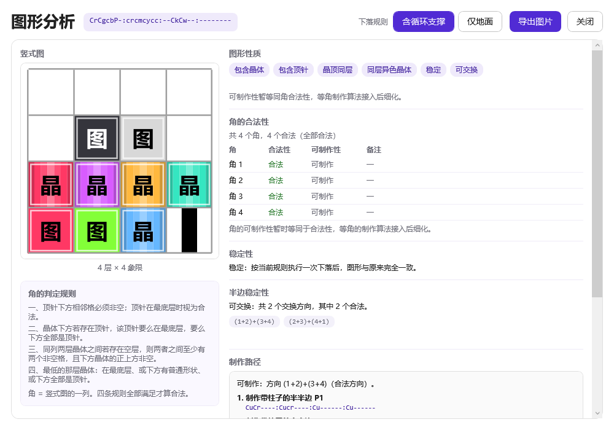
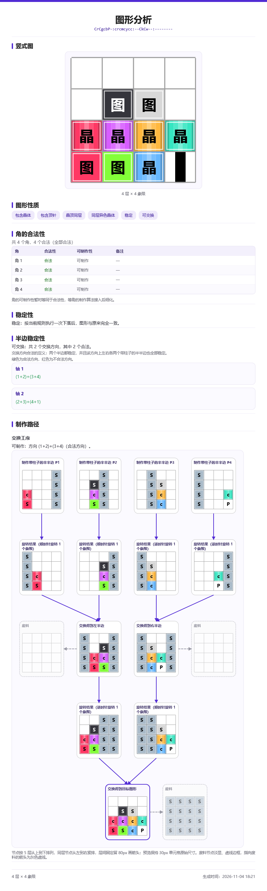

# 竖式图编辑器

把图形短代码转成竖式图、编辑图形并导出结果的工具，同一套核心逻辑提供 **Web / Android / Windows** 三个平台。

当前版本：**1.4.0**



工作区（制作路径）：



导出的路径图：



## 在线使用与下载

| 平台 | 入口 | 说明 |
| --- | --- | --- |
| Web | [wyucnk.github.io/ShapeEditor](https://wyucnk.github.io/ShapeEditor/) | Blazor WebAssembly + PWA，可离线使用 |
| Windows | [下载 EXE](https://github.com/WyuCnk/ShapeEditor/releases/latest/download/ShapeEditor-Windows-x64.exe) | 单文件自包含，约 59 MB，双击即用，无需安装 .NET |
| Android | [下载 APK](https://github.com/WyuCnk/ShapeEditor/releases/latest/download/ShapeEditor-android-universal.apk) | 通用包（arm64 / arm / x64），最低 Android 5.0 |
| 所有版本 | [Releases](https://github.com/WyuCnk/ShapeEditor/releases) | |

三个客户端共用同一份存档格式（JSON，`Version: 1`），互相导入导出没有障碍。

## 功能

三个平台能力基本一致：

- 解析、编辑、导出短代码，支持**短代码**与**超短代码**两种写法
- 层数 1–100、象限数 2–100 且**必须为偶数**（切割要沿中线均分），单元格总数上限 10000
- 竖式图显示：**最高层在上，最低层在下**
- 形状画笔（空 / 顶针 / 晶体 / 普通形状）、颜色画笔（9 色），可组合使用
- 整体上移 / 下移，同层象限循环左移 / 右移
- 画布缩放与平移，选中单元格查看其短代码
- 撤销 / 重做（上限 100 步）
- 导出完整竖式图 PNG；Windows 还支持把图片复制到剪贴板
- 存档导入导出（JSON），自动保存并在下次打开时恢复
- 批量查看：粘贴或导入 txt（一行一条），分页缩略图，上一条 / 下一条切换
- 图形分析：图形性质标签、逐角合法性、稳定性、半边稳定性与制作路径；Web / Windows 可导出分析图 PNG
- 工作区：多画布标签页 + 共享素材库，节点间做下落 / 顶针 / 切割 / 堆叠 / 交换，导出路径图 PNG
- 跨页面：工作区与批量查看里选中的图形，可直接加入编辑区或送去分析

## 工作区（制作路径）

三个平台都有「工作区」页，用来把多个图形串成一条制作路径：

- **多工作区**：标签页切换，可新建、双击重命名、删除；每个工作区独立保存画布、下落规则与高度上限
- **共享素材库**：编辑器「加入工作区」导入，所有工作区共用一份；把素材拖进画布即建节点（Web/WPF 也支持双击素材）
- **素材删除**：素材卡片上的删除按钮 + 二次确认；只从素材库移除，画布上已经拖出的节点不受影响
- **象限数锁定**：工作区里出现的第一个图形决定象限数（空工作区为 4），之后导入不同象限数的图形会被拒绝
- **节点运算**：选中节点后用工具条执行 下落 / 顶针 / 切割（一次生成东、西两个结果）/ 堆叠（两击：点第二个输入）/ 交换（两击：依次点两个输入）
- **交换**：两个输入各切割一次，再交叉拼接，并排生成两个标题为「交换结果」的输出节点；切换下落规则后自动重算
- **节点外观**：只有编号、标题、竖式图；宽 = 象限数 × 30 + 16，高 = 50 + 层数 × 30，格子固定 30×30 不压缩
- **自由拖动**：拖节点标题即可移动，连线实时跟随；三端都支持
- **自动布局**：一键按依赖关系分层排列（根在上、结果逐层向下，层内按父节点位置排序并水平居中）
- **复制 / 粘贴 / 删除**：复制生成独立素材节点；删除只向下级联，不会删上游
- **跨页面**：选中素材或节点后可「加到编辑区」载入编辑器，或「分析」打开分析页 / 窗口
- **规则与上限**：切换「含循环支撑 / 仅地面」或修改高度上限（4–100，默认 4）后，整张图（含交换结果）按依赖顺序重算
- **导出**：路径图画布按节点包围盒裁切，1 倍输出，节点内画 `c` 晶体 / `S` 普通形状 / 顶针白底黑条，连线不标文字；工作区可导出 / 导入 JSON。Android 的导出分辨率与画布缩放、平移无关

各平台差异：

| 能力 | Web | Android | Windows |
| --- | --- | --- | --- |
| 分享图片 | 系统分享（浏览器支持时） | 系统分享 | 导出 + 剪贴板 |
| 自动保存位置 | 浏览器 localStorage | 应用私有存储 | `%LOCALAPPDATA%\ShapeEditor\autosave.json` |
| 工作区操作 | 工具条 + 快捷键 | 工具条 | 工具条 + 快捷键 |
| 画布缩放 / 平移 | 滚轮缩放 + 拖动平移 | 双指缩放（0.4–2.0）+ 单指平移 | 滚轮 / 中键拖动 / 空格+左键拖动 |
| 节点拖动 | 鼠标拖动 | 缩放后不稳定，建议自动布局 | 鼠标拖动 |
| 自动布局 | ✅ | ✅ | ✅ |
| 快捷键 | 浏览器默认 | — | 全套（见下） |

Android 的工作区画布支持双指缩放（0.4–2.0）与单指平移，右下角另有缩放按钮；导出图片固定按 1 倍输出，不受缩放影响。缩放画布下的节点拖动目前表现不稳定，建议先用「自动布局」排好再微调；桌面端拖动正常。

## 图形分析





三个平台的编辑器顶部都有「分析」按钮（Windows 打开独立窗口，Web / Android 进入分析页），对当前图形做一次静态检查：

- **图形性质**：以标签列出——包含晶体、包含顶针、晶空同层、晶顶同层、图下间隙、晶下间隙、同层异色晶体、循环支撑结构、稳定、可交换
- **角的合法性**：角 = 竖式图的一列，逐角给出 角 / 合法性 / 可制作性 / 备注 四列，备注写明违反的规则
- **稳定性**：按当前下落规则执行一次下落，结果与原图形完全一致才算稳定
- **半边稳定性**：按轴分组列出交换方向并逐条判定，任一方向合法即「可交换」
- **制作路径**：给出可制作 / 不可制作与所用方向；可制作时列出步骤链
- **角的判定规则**：四条规则单独列出

分析页顶部可切换下落规则（含循环支撑 / 仅地面），切换后整个分析页——包括稳定性、半边稳定性与制作路径——都按新规则重算。

Web 版的分析页还能逐板块「显示 / 隐藏」，导出的分析图只包含当时可见的板块。Web 与 Windows 都支持导出单栏 PNG（含表格与制作路径步骤），Android 暂不支持导出。

### 角的四条判定规则

| 规则 | 判定 |
| --- | --- |
| 一 | 顶针下方相邻格必须非空；顶针在最底层时视为合法 |
| 二 | 晶体下方若存在顶针，该顶针要么在最底层，要么下方全部是顶针 |
| 三 | 同列两层晶体之间若存在空层，则两者之间至少有两个非空格，且下方晶体的正上方非空 |
| 四 | 最低的那层晶体：在最底层、或下方有普通形状、或下方全部是顶针 |

四条全部满足才算合法角。「可制作性」一栏目前与合法性一致，等角的制作算法细化后再区分。

### 半边稳定性

交换方向 = 轴（n/2 个）× 左切点（n/2−1）× 右切点（n/2−1），方向总数为 `n/2 × (n/2−1)²`（n 为象限数）。某方向合法 ⇔ 两个半边都稳定，且该方向上左右各两个带柱子的半半边也全部稳定；只要有一个合法方向就判定为「可交换」。

### 制作路径

可制作时按顺序给出步骤与每步短代码：

1. 制作带柱子的半半边 P1–P4
2. 交换得到左半边
3. 交换得到右半边
4. 交换得到目标图形
5. 顶针与堆叠（待接入）

目前只解析到交换阶段，最后一步是占位。解析过程复用稳定性缓存、旋转归一化键并带早退，n = 20 的单层全晶体目标约 4 ms 就能给出结果。

## Windows 快捷键

首次使用按 **F1** 查看完整说明（菜单里也有入口），常用如下：

| 快捷键 | 功能 |
| --- | --- |
| `Ctrl + Z` / `Ctrl + Y` | 撤销 / 重做 |
| `Ctrl + Enter` | 解析输入框里的短代码 |
| `Ctrl + 0` | 适应屏幕 |
| `Ctrl + C` / `Ctrl + V` | 复制 / 粘贴短代码（焦点在输入框时走系统行为） |
| `Ctrl + S` / `Ctrl + O` | 导出 / 导入存档 |
| 工作区：`Ctrl + C` / `Ctrl + V` / `Delete` | 复制 / 粘贴 / 删除选中节点 |
| 工作区：`Esc` | 取消堆叠 / 交换等待 |
| `Ctrl + Shift + S` | 导出图片 |
| `Delete` / `Esc` | 清空选中单元格 / 取消画笔与选中 |
| `↑ ↓ ← →` | 移动模式下整体移动 |
| 滚轮 / 中键拖动 / 空格+左键拖动 | 缩放 / 平移画布 |

## 短代码规则

冒号 `:` 分隔不同层，**第一段是最低层**；每两个字符表示一个象限，同一层按短代码顺序从左到右排列。

```text
CrP---Gu:ckckckck
```

表示两层、每层四个象限；竖式图显示时，第二段位于第一段上方。象限数只能是偶数：奇数象限无法沿中线均分切割，解析时会直接报错。

| 代码 | 含义 |
| ---- | ---- |
| `--` | 空位 |
| `P-` | 顶针 |
| `cr` | 红色晶体 |
| `Cu` | 未着色普通形状 |
| `Gu` | 未着色的 G 普通形状 |

颜色字符：`r`、`g`、`b`、`c`、`m`、`y`、`w`、`k`、`u`，其中 `u` 是未着色，与空位/顶针的 `-` 不同。

### 超短代码

只描述形状、不带颜色：**每一位一个象限**，冒号同样分层。`C` 普通形状、`c` 晶体、`P` 顶针、`-` 空位，普通形状字母沿用 `A`–`Z`（`P` 除外）。

> 工作区预览与图例使用另一套**显示字母**：`c` 晶体、`S` 普通形状、`P` 顶针、`-` 空位。这套字母只用于看图，不参与编码，超短代码仍是上面无损的写法。

```text
CcCc
```

表示一层四个象限：图、晶、图、晶。解析时颜色按默认值补齐（普通形状未着色 `u`、晶体红色 `r`），因此随时可以再导出为带颜色的完整短代码。

## 项目结构

```text
ShapeEditor.Core/    图形模型、短代码解析与导出、主题常量（三端共享）
ShapeEditor.Web/     Blazor WebAssembly 在线版与 PWA
ShapeEditor.Maui/    Android 应用（MAUI 单项目）
ShapeEditor.Wpf/     Windows 桌面客户端（WPF）
ShapeEditor.Tests/   零依赖测试项目
Directory.Build.props  产品版本与 Android versionCode 的唯一来源
ShapeEditor.slnx     解决方案
```

三个界面都以 `ShapeEditor.Core` 为唯一真源：短代码解析/导出、文档模型、调色板与晶体条带算法都不在界面层重复实现。

## 本地开发

需要 .NET 10 SDK；Android 另外需要 MAUI 工作负载、Android SDK 与 JDK。

```powershell
# Web（热重载）
dotnet watch --project .\ShapeEditor.Web\ShapeEditor.Web.csproj

# Windows 客户端
dotnet run --project .\ShapeEditor.Wpf\ShapeEditor.Wpf.csproj

# 测试（80 项）
dotnet run --project .\ShapeEditor.Tests\ShapeEditor.Tests.csproj -c Release

# Android（按需传入本机 SDK 与 JDK 路径）
dotnet build .\ShapeEditor.Maui\ShapeEditor.Maui.csproj -f net10.0-android `
  -p:AndroidSdkDirectory="D:\AndroidSdk" -p:JavaSdkDirectory="D:\AndroidJdk"
```

### 发布 Windows 单文件

```powershell
dotnet publish .\ShapeEditor.Wpf\ShapeEditor.Wpf.csproj -c Release -p:PublishProfile=win-x64
```

输出在 `ShapeEditor.Wpf\bin\Release\net10.0-windows\publish\win-x64\ShapeEditor.Wpf.exe`。

### 离屏自检

没有图形界面时可以渲染界面到 PNG 验证绘制：

```powershell
.\ShapeEditor.Wpf\bin\Debug\net10.0-windows\ShapeEditor.Wpf.exe --render-test .\artifacts\render
```

## 版本管理

三端共用一个产品版本号，定义在 `Directory.Build.props` 的 `ProductVersion`，发版只改这一处：

- WPF：程序集版本与状态栏显示
- Web：顶栏显示（读取程序集 `InformationalVersion`）
- Android：`ApplicationDisplayVersion`，`versionCode` 由 `major*10000 + minor*100 + patch` 自动派生（只增不减）

## 发布流程

```powershell
# 1. 修改 Directory.Build.props 里的 ProductVersion
# 2. 提交后打标签
git tag -a v1.4.0 -m "ShapeEditor 1.4.0"
git push origin v1.4.0
```

打 `v*` 标签会触发 `.github/workflows/release.yml`：同时构建 Windows 单文件 EXE 与签名 APK，汇总到同一个 Release。网页上的两个下载按钮固定指向 `releases/latest/download/<固定文件名>`，因此发版后无需改网页。

推送 `main` 会触发 `deploy-pages.yml` 自动部署 Web 版。

## 更新日志

### 1.4.0

- **图形分析（三端）**：编辑器顶部新增「分析」，覆盖图形性质、角合法性、稳定性、半边稳定性与制作路径；Web 分析页可按板块显隐，Web / Windows 可导出单栏分析图
- **工作区「交换」**：两个输入各切割一次后交叉拼接，并排生成两个「交换结果」节点
- **素材删除**：素材卡片可删除（二次确认），画布上已拖出的节点不受影响
- **跨页面协作**：工作区与批量查看里选中的图形可直接加入编辑区或送去分析
- **Android 工作区缩放**：双指缩放 0.4–2.0、单指平移，导出分辨率不受缩放影响
- **核心规则**：全解决方案禁止奇数象限；制作路径解析加入稳定性缓存、旋转归一化键与早退，n = 20 单层全晶体约 4 ms
- 测试增至 80 项

## 后续计划

- 制作路径的顶针与堆叠步骤尚未接入
- 角的「可制作性」目前等同合法性，等角的制作算法细化后再区分
- 批量查看导出长图（列表过长时的分页导出方案仍在设计）
- 改进 Android 缩放画布下的节点拖动
- 持续优化 Web 版移动端体验

## 反馈

发现短代码解析、显示或导出问题，欢迎在 [Issues](https://github.com/WyuCnk/ShapeEditor/issues) 反馈，并附上短代码、预期结果与实际截图。
